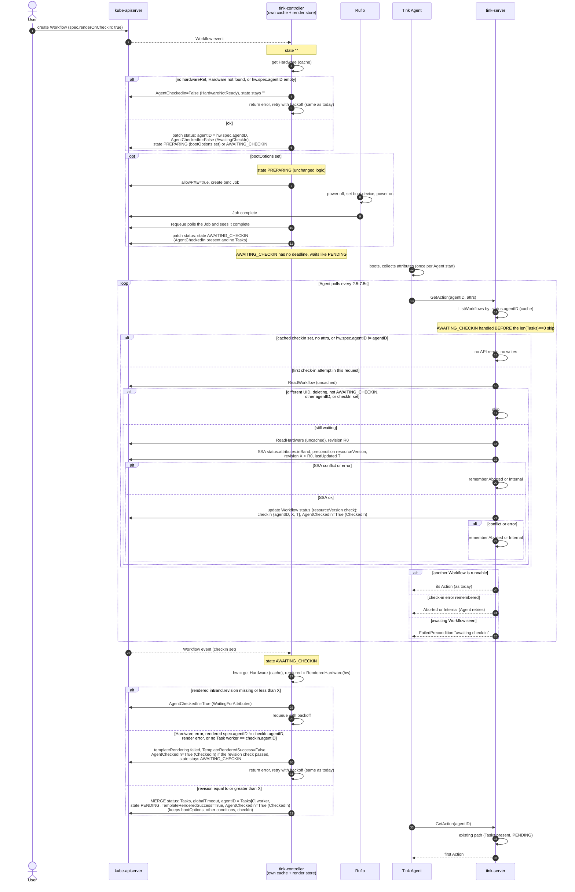

# Rendering a Workflow's Template on Agent Check-in

Status: proposed

Issue: [#900](https://github.com/tinkerbell/tinkerbell/issues/900)

## 1. Problem

A Template can't use the in-band attributes (CPU, memory, disks, NICs, ...) that the Agent
collects for the run the Template is rendered for.

- tink-controller renders the Template once, when the Workflow is created, with the Hardware
  object as it is at that moment.
- tink-server writes the Agent's attributes to `Hardware.status.attributes.inBand` later, when
  it serves the first Action of the Workflow.

So a Hardware's first Workflow renders with no in-band attributes, and every later Workflow
renders with whatever a previous run reported. A Template can't react to the machine it's
about to provision.

## 2. Goals

- A Workflow can opt in to rendering its Template after the target Agent has checked in, with
  the attributes from that check-in.
- Rendering stays in tink-controller. tink-server doesn't read Templates or resolve references.
- No Agent changes. The Agent keeps polling `GetAction` as it does today.
- Workflows that don't opt in behave exactly as they do today.
- The Hardware stays the authority on which Agent belongs to it.

## 3. Non-goals

- Re-rendering a Workflow that has already been rendered.
- Deferring rendering per Task. The v1alpha2 API (per-Task `agentID`, `hardware`,
  `timeoutSeconds`) is a better fit for that.
- A timeout while waiting for check-in. A Workflow waits as long as a PENDING Workflow does
  today.
- Cleaning up boot options (allowPXE, mounted ISO) when a Workflow fails. Nothing does that
  today, and this design doesn't change it.
- Writing the legacy `tinkerbell.org/agent-attributes` annotation at check-in.
  `status.attributes.inBand` is the data a Template should use.
- Auto-enrolled Workflows. They can opt in through their WorkflowRuleSet later, but that is
  not designed here.

## 4. Background

### 4.1 Rendering today

`tink/controller/internal/workflow/reconciler.go`, state `""`:

1. Get the Template and the Hardware (controller cache).
2. `RenderedHardware`: the Hardware with its own spec templates rendered (see
   [HARDWARE_TEMPLATING.md](HARDWARE_TEMPLATING.md)).
3. Build the template data: `hardwareMap` entries, `.hardware` (the whole rendered Hardware,
   status included), the legacy `.Hardware` contract, and `.references`.
4. Render, then **replace** `status` with the Tasks, `agentID` (the first Task's worker) and
   `globalTimeout`.
5. Move to PREPARING when boot options are set, otherwise PENDING.

On a render error, the controller sets `templateRendering: failed` and
`TemplateRenderedSuccess=False`, leaves the state at `""`, and retries with backoff. Fixing the
Template recovers the Workflow.

### 4.2 Serving the first Action today

All of it happens in tink-server's `GetAction` (`tink/server/internal/grpc/grpc.go`):

1. List the Workflows whose `status.agentID` is the polling Agent (indexed, cached).
2. Skip a Workflow with no Tasks, one in PREPARING with a boot mode, and one not in PENDING or
   RUNNING.
3. If `Tasks[0].Actions[0]` is still PENDING, this is the first Action. Write the legacy
   annotation (write-once).
4. Check that the Task belongs to the polling Agent.
5. On the first Action of any Task, write `status.attributes.inBand` with Server-Side Apply,
   but only when the polling Agent is `hw.spec.agentID`. Errors are logged, not returned.
6. Set `status.currentState` and return the Action.

The controller decides *when* a Workflow is eligible (by giving it Tasks and setting PENDING).
tink-server decides *which* Action to serve.

### 4.3 Caches between a write and a render

Three layers can lag between tink-server writing attributes and the controller rendering with
them:

1. **Two informer caches.** tink-controller runs its own controller-runtime manager, separate
   from the kube backend's cache that tink-server uses. Workflow and Hardware events arrive on
   separate streams, with no ordering between them.
2. **The Hardware render store.** `RenderedHardware` serves the newest successful rendering
   while a newer resourceVersion is still rendering, and that copy carries the previous
   `status`. Once rendering a version fails, the store serves nothing for that Hardware and
   `RenderedHardware` returns an error until a later version renders.
3. **The Agent.** It collects attributes once, when it starts, and sends the same set on every
   poll.

The workflow controller watches only Workflows. A Hardware change doesn't trigger a Workflow
reconcile; Job progress in PREPARING is also found by requeueing, not by events.

## 5. Design

### 5.1 API

**Workflow spec** (`api/v1alpha1/tinkerbell/workflow.go`):

```go
type WorkflowSpec struct {
    // ...

    // RenderOnCheckIn defers rendering the Template until the Hardware's Agent checks in,
    // so the Template can use the in-band attributes from this run.
    // HardwareRef must be set, and the Hardware must have spec.agentID.
    // +optional
    RenderOnCheckIn bool `json:"renderOnCheckIn,omitempty"`
}
```

The field is a plain switch. The Agent is always `hw.spec.agentID`; the Workflow can't name a
different one.

**Workflow state:**

```go
WorkflowStateAwaitingCheckIn = WorkflowState("AWAITING_CHECKIN")
```

**Workflow condition:**

```go
AgentCheckedIn WorkflowConditionType = "AgentCheckedIn"
```

| Status | Reason | Set by | Meaning |
|---|---|---|---|
| False | `HardwareNotReady` | controller | The Workflow can't wait for a check-in yet: no `hardwareRef`, Hardware not found, or no `hw.spec.agentID`. |
| False | `AwaitingCheckIn` | controller | Waiting for the Agent to check in. |
| True | `CheckedIn` | tink-server, controller | Check-in recorded. The controller sets it back to this reason once the rendered Hardware has the check-in's attributes. |
| True | `WaitingForAttributes` | controller | Checked in, but the rendered Hardware doesn't have this check-in's attributes yet. |

Only deferred Workflows get this condition. The controller uses its presence to tell a deferred
Workflow apart (§5.4), instead of re-reading the spec switch.

**Workflow status:**

```go
type WorkflowStatus struct {
    // ...

    // CheckIn records the Agent check-in that a deferred render waits for.
    // +optional
    CheckIn *CheckIn `json:"checkIn,omitempty"`
}

// CheckIn is the Agent check-in a deferred render uses.
type CheckIn struct {
    // AgentID is the Agent that checked in.
    AgentID string `json:"agentID"`
    // Revision is the status.attributes.inBand revision written at check-in.
    Revision string `json:"revision"`
    // LastUpdated is when the check-in was recorded. It equals the lastUpdated of the
    // status.attributes.inBand write.
    // +optional
    LastUpdated *metav1.Time `json:"lastUpdated,omitempty"`
}
```

`lastUpdated` is for people reading the Workflow. The controller compares only `revision`
(§5.7).

**Hardware attributes** (`api/v1alpha1/tinkerbell/hardware.go`):

```go
type Attributes struct {
    // ...

    // Revision identifies one write of this subtree. Each successful write stores a ULID
    // greater than the one it replaced, so a greater revision was written later.
    // +optional
    Revision string `json:"revision,omitempty"`
}
```

`Attributes` is shared by `inBand` and `outOfBand`. Only tink-server sets `revision`, and only
on `inBand` (§5.5). Rufio can set it on `outOfBand` later; nothing here needs it to.

**Hardware apply configuration:** `HardwareApplyMetadata` gains `ResourceVersion`, so an apply
can be made conditional on the Hardware not having changed (§5.5).

### 5.2 States

```text
""  ->  [PREPARING]  ->  AWAITING_CHECKIN  ->  PENDING  ->  RUNNING  ->  ...
```

PREPARING runs first when boot options are set, because the machine has to boot before its
Agent can check in. Without boot options, the Workflow goes straight to AWAITING_CHECKIN.

### 5.3 Controller: new Workflow

In state `""`, when `spec.renderOnCheckIn` is true:

1. Get the Hardware from `spec.hardwareRef`. If there's no `hardwareRef`, the Hardware isn't
   found, or `hw.spec.agentID` is empty, set `AgentCheckedIn=False` (`HardwareNotReady`) with
   the reason, leave the state at `""`, and retry with backoff. This matches how a missing
   Template or Hardware is handled today, without marking a render that hasn't happened as
   failed.
2. Set `status.agentID = hw.spec.agentID`. The existing `.status.agentID` index then finds the
   Workflow in `GetAction`. No new index is needed.
3. Set `AgentCheckedIn=False` (`AwaitingCheckIn`).
4. Move to PREPARING when boot options are set, otherwise AWAITING_CHECKIN.

Don't get or render the Template.

**Disabled Workflows:** as today, only `status.agentID` is written and the state stays `""`.

**Other spec fields:** `renderOnCheckIn` is only read in state `""`. Changing it later has no
effect.

### 5.4 Controller: PREPARING

`prepareWorkflow` moves to PENDING in four places (netboot, isoboot, customboot, and the
default for `toggleAllowNetboot` only). Replace them with a helper that returns
AWAITING_CHECKIN when the Workflow has the `AgentCheckedIn` condition and no Tasks yet, and
PENDING otherwise. The helper reads status, not `spec.renderOnCheckIn`, so changing the switch
during PREPARING can't send an unrendered Workflow to PENDING.

Nothing else in PREPARING changes. Job completion is still found by requeueing.

### 5.5 tink-server: in-band attribute writes

Every write of `status.attributes.inBand` (the check-in in §5.6 and the existing first-Action
write in §4.2 step 5) is conditional, so stored revisions increase in the order writes succeed:

1. Read the Hardware from the API server (uncached). Check that `hw.spec.agentID` is the
   polling Agent.
2. Generate the revision with `ulid.Make()`. If it isn't greater than the stored revision (a
   clock behind the one that wrote it), use the next ULID after the stored one. Don't derive it
   from `Handler.NowFunc`; tests set that to the zero time.
3. Apply `inBand` with the revision and `lastUpdated`, in one Server-Side Apply as today, with
   `metadata.resourceVersion` set to the value from step 1. If anything wrote the Hardware
   since the read, the API server rejects the apply with a conflict.

ULID generation order and clock differences between tink-server replicas don't matter: a write
based on an older read fails instead of overwriting a newer revision.

The cost is one uncached read per write. These writes happen only at check-in and on the first
Action of each Task served to the Hardware's Agent.

On the first-Action path, a failed write is still only logged; the Action is served as today.

### 5.6 tink-server: check-in

`GetAction` keeps its single scan over the listed Workflows. A Workflow in AWAITING_CHECKIN is
handled **before** the "no Tasks" skip; otherwise it is never seen. For each one:

1. Note that an awaiting Workflow was seen.
2. Cheap checks first, from the cache. `continue` if this request has already attempted a
   check-in, the cached Workflow has `status.checkIn`, or the Agent sent no attributes
   (attribute detection is off). This keeps idle polls from reading the API server.
3. Read the Hardware named by **this Workflow's** `spec.hardwareRef` from the cache. Don't reuse
   the Hardware found by auto discovery without checking that it's the same object.
   `continue` if `hw.spec.agentID` isn't the polling Agent. The Hardware is the authority.
4. Note that this request has attempted a check-in. A failed attempt counts too.
5. Read the Workflow from the API server (uncached). `continue` unless it is the same Workflow
   and still waiting: the same UID as the cached copy, no deletion timestamp, state
   AWAITING_CHECKIN, `status.agentID` is the polling Agent, and no `status.checkIn`. This stops
   a Workflow that was deleted and recreated under the same name from being checked in before
   its own boot. Not found: `continue`. Any other read error: remember it as `Internal`.
6. Write `inBand` as in §5.5. On conflict remember `Aborted`; on any other error remember
   `Internal`.
7. Set `status.checkIn = {agentID, revision, lastUpdated}`, using the values from step 6, and
   `AgentCheckedIn=True` (`CheckedIn`). Update the Workflow status from the object read in
   step 5. The update carries its resourceVersion, so a concurrent controller write makes it
   fail. On conflict remember `Aborted`; on any other error remember `Internal`. The Agent's
   retry writes a new revision.
8. `continue`.

Errors are remembered, not returned, so an awaiting Workflow never hides a runnable one. As
today, the scan stops at the first runnable Workflow, so an awaiting Workflow listed after it is
checked in once the Agent has no other work.

After the scan, in order:

1. A runnable Workflow was found: serve it as today.
2. A check-in error was remembered: return it. The Agent retries (`Aborted`) or backs off
   (`Internal`).
3. An awaiting Workflow was seen: return `FailedPrecondition` ("Workflow is awaiting
   check-in"). The Agent treats it as idle and polls again, the same as for PREPARING.
4. Otherwise, the existing answers (preparing, not running, no Tasks).

### 5.7 Controller: render after check-in

In state AWAITING_CHECKIN:

1. If `status.checkIn` isn't set, do nothing. tink-server's status write triggers the next
   reconcile.
2. Get the Hardware (cache) and `RenderedHardware`. Errors (Hardware not found, Hardware that
   failed to render) are handled in step 7.
3. Compare `rendered.status.attributes.inBand.revision` with `checkIn.revision`. Canonical ULID
   strings sort in the same order as their values, so a string comparison works:

   | Rendered revision | Action |
   |---|---|
   | equal | Continue. |
   | greater | Continue. It was written after the check-in (§5.5), by the same Agent. |
   | less, or missing | Set `AgentCheckedIn=True` (`WaitingForAttributes`) and requeue with the reconciler's backoff. |

   Because writes are conditional (§5.5), "less" only means a cache or the render store hasn't
   caught up yet. Checking the *rendered* copy covers all of §4.3: a rendering is one whole
   Hardware version, spec and status together, and Hardware rendering never changes `status`.
   Once this check passes, set `AgentCheckedIn=True` (`CheckedIn`) again.

4. If `rendered.spec.agentID` no longer equals `checkIn.agentID`, treat it as an error (step 7).
   Check the rendered copy, not the cached one: it's the copy whose revision passed step 3 and
   whose attributes the Template uses, and `RenderedHardware` can return a different
   resourceVersion than the cache.
5. Get the Template and render it with the same data as today (§4.1 step 3).
6. Check that at least one rendered Task's worker is `checkIn.agentID`. The first Task can belong
   to another Agent (an administrative Agent, for example).
7. On any error in steps 2, 4, 5 or 6: set `templateRendering: failed` and
   `TemplateRenderedSuccess=False` with the error, leave the state at AWAITING_CHECKIN, and
   retry with backoff. Fixing the Template or the Hardware recovers the Workflow without another
   boot.
8. On success, **merge** into `status`: Tasks, `globalTimeout`, `agentID` (the first Task's
   worker), `templateRendering: successful`, `TemplateRenderedSuccess=True`, and state PENDING.
   Keep everything else: `bootOptions` (allowPXE and Job state, which POST needs), the other
   conditions, and `checkIn`.

Set every condition in this state with `SetConditionIfDifferent`, so retries don't rewrite the
status each time.

The existing path keeps replacing `status` in full. The deprecated `STATE_PENDING` handling
depends on that replacement resetting the state to `""`.

### 5.8 Serving the first Action

Nothing changes. On the next poll the Workflow has Tasks and is PENDING, so `GetAction` serves
the first Action as in §4.2.

If the first Task belongs to an administrative Agent, `status.agentID` is now that Agent. The
Workflow is no longer listed for the Hardware's Agent, which gets "no Workflows found" until its
Task comes up. With auto enrollment enabled, that answer also starts enrollment for the
Hardware's Agent. Multi-Agent Workflows already behave this way today.

The first-Action path writes `inBand` again, with a new revision (§5.5). That's harmless.

### 5.9 Waiting and failure

- **No timeout.** AWAITING_CHECKIN waits indefinitely, like PENDING. Delete the Workflow to
  abandon it. That leaves allowPXE on and an ISO mounted, the same as deleting a Workflow stuck
  in PENDING after PREPARING today.
- **Render errors**, including a Hardware that's missing or fails to render, stay in
  AWAITING_CHECKIN and show in `TemplateRenderedSuccess` (§5.7 step 7).
- **No new FAILED transitions and no cleanup.** FAILED and TIMEOUT still skip POST.
- **Waiting for attributes** shows in `AgentCheckedIn` (`WaitingForAttributes`). It normally
  clears within one requeue. It persists when the Hardware was replaced after check-in and the
  new object has no newer attributes (§7).

### 5.10 Sequence



## 6. Writing Templates for this

The rendered Hardware, status included, is available as `.hardware`. In-band attributes are
under `.hardware.status.attributes.inBand`, with the JSON field names:

```yaml
tasks:
  - name: provision
    worker: "{{ .hardware.spec.agentID }}"
    actions:
      - name: stream-image
        image: quay.io/tinkerbell/actions/image2disk
        environment:
          DEST_DISK: "/dev/{{ (index .hardware.status.attributes.inBand.blockDevices 0).name }}"
```

The legacy `.Hardware` contract doesn't include status.

Every Template should tolerate missing attributes. An Agent may not report a field, and the
same Template can be used by a Workflow that doesn't render on check-in.

## 7. Edge cases

| Case | Behavior |
|---|---|
| Several Workflows for the same Agent | At most one check-in attempt per request. Check-in errors don't hide a runnable Workflow; they're returned only when nothing can be served (§5.6). |
| Two deferred Workflows for the same Hardware | Each records its own revision. The later one is greater, which the "greater" rule in §5.7 accepts for the earlier Workflow. |
| Concurrent writes to the same Hardware, or several tink-server replicas | Writes are conditional (§5.5). The one based on an older read fails and the Agent retries, so a stored revision is never replaced by a smaller one. Clock differences don't matter. |
| Agent restarted, or long-running | Attributes are collected when the Agent starts. A check-in carries what the Agent sent for this run, not necessarily a fresh collection. |
| `hw.spec.agentID` changed while waiting | `status.agentID` still has the old ID, so the new Agent doesn't find the Workflow. Recreate the Workflow. After check-in, the change is an error (§5.7 step 4). |
| Hardware deleted and recreated after check-in | While it's missing, the controller reports a Hardware error and retries. The new object starts with no revision, so the Workflow waits with `WaitingForAttributes`. If the Hardware's Agent later writes attributes to the new object (for example through another Workflow), that revision is greater, and the Workflow renders with those attributes. They come from the same Agent. |
| Workflow deleted and recreated under the same name | tink-server checks the UID and state on its uncached read (§5.6 step 5), so the new Workflow isn't checked in before its own PREPARING finishes. |
| Hardware spec templates that use `status.attributes.inBand` | They must render without in-band attributes. Before the first check-in there are none, and a Hardware that fails to render isn't served to Smee, so the machine can't boot and never checks in. Use defaults (for example with `dig`) for values needed to boot. |
| First Task must run before the machine boots (for example switch setup) | Not supported in this mode. The whole Template waits for the Hardware's Agent. |
| Agent with attribute detection off | It never checks in. The Workflow waits in AWAITING_CHECKIN. |

## 8. Alternatives considered

- **Opt-in on the Template.** Deferring is a choice about one run, like `disabled` or
  `bootOptions`, and the same Template should work either way.
- **Render in tink-server at check-in** (#1040 and follow-ups). It needs Template reads and
  reference resolution in tink-server, a shared render package, indexes on `hardwareMap` or
  `hardwareRef` (the Agent ID isn't known before rendering), and a guard against concurrent
  check-ins. It saves one poll interval.
- **Snapshot of the attributes on the Workflow.** tink-server writes the attributes into
  Workflow status, and the controller renders with them. Nothing can be stale, but the
  attributes are stored twice and the Hardware render needs a way to take a snapshot. Not
  needed once the revision check exists.
- **Compare `lastUpdated` timestamps.** `metav1.Time` is stored to the second, so two writes
  can tie.
- **Compare Hardware resourceVersions.** They can only be compared for equality, and any other
  Hardware write (the allowPXE toggle, Rufio's out-of-band attributes) changes them.
- **Unconditional writes, relying on ULID order.** Two overlapping writes can be stored in the
  opposite order to their ULIDs. A Workflow could then wait forever, because tink-server stops
  writing once a check-in is recorded.
- **A plain counter instead of a ULID.** With conditional writes either gives the ordering. A
  ULID also carries the time of the write and doesn't need the previous value to be unique.
- **Binding the check-in to the Hardware UID.** It would stop a replacement Hardware's
  attributes from being used. But recreating a Hardware to fix its spec would leave the Workflow
  waiting forever, because tink-server doesn't record a second check-in and there's no timeout.
  The replacement's attributes come from the same Agent, so they're accepted.
- **An agent ID on the Workflow.** Either it repeats `hw.spec.agentID`, or it lets someone who
  can create Workflows choose which Agent's data lands on a Hardware. The Hardware is the
  authority.
- **Timeout and cleanup.** Left out to match how PENDING and failures behave today.

## 9. Decisions

1. The opt-in is `spec.renderOnCheckIn` on the Workflow, a plain switch.
2. Only tink-controller renders Templates.
3. The Agent is always `hw.spec.agentID`. The Workflow can't name one.
4. tink-server writes `inBand` with a ULID `revision`, then records `{agentID, revision,
   lastUpdated}` on the Workflow. The controller renders when the rendered Hardware's revision
   is equal or greater. `lastUpdated` is only for people reading the Workflow.
5. Every `inBand` write is conditional on the Hardware's resourceVersion and stores a revision
   greater than the one it replaces.
6. The check-in isn't bound to the Hardware UID.
7. `revision` is a field on the shared `Attributes` type, next to `lastUpdated`.
8. No timeout in AWAITING_CHECKIN.
9. Render errors stay in AWAITING_CHECKIN and retry, as they stay in `""` today. No cleanup.
10. PREPARING comes before AWAITING_CHECKIN.
11. The deferred render merges into `status`; the existing path keeps replacing it.

## 10. Implementation

1. **API:** `renderOnCheckIn`, `AWAITING_CHECKIN`, `AgentCheckedIn`, `status.checkIn`,
   `Attributes.revision`, `HardwareApplyMetadata.ResourceVersion`. Regenerate deepcopy and CRDs.
2. **kube backend:** an uncached Hardware read, and `ApplyHardwareInBandAttributes` taking the
   resourceVersion precondition and returning conflicts as such.
3. **tink-server:** conditional `inBand` writes with a revision on both paths (§5.5); the
   AWAITING_CHECKIN handling in `GetAction` with remembered errors (§5.6).
4. **tink-controller:** the `""` branch for deferred Workflows, the next-state helper in
   `prepareWorkflow`, the AWAITING_CHECKIN case with the revision check, and the status merge.
5. **Docs:** the Workflow field, §6 and the Hardware template limit from §7 in the user docs.

Tests:

- Controller: deferred Workflow without `hardwareRef` or `hw.spec.agentID`, then fixed; disabled
  deferred Workflow; PREPARING then AWAITING_CHECKIN for each boot mode; `renderOnCheckIn`
  turned off during PREPARING; revision missing, less, equal and greater; `RenderedHardware`
  error; render error stays in AWAITING_CHECKIN and recovers after a Template fix; rendered
  Hardware with a different `spec.agentID` than the cached one; worker check
  with an administrative first Task; `AgentCheckedIn` back to `CheckedIn` after
  `WaitingForAttributes`; merge keeps `bootOptions` and conditions; the existing path is
  unchanged.
- tink-server: check-in before the "no Tasks" skip; no API reads once `checkIn` is set or
  without attributes; no check-in for an Agent that isn't `hw.spec.agentID`; recreated Workflow
  (different UID, PREPARING) isn't checked in; Hardware apply conflict and other errors are
  remembered and returned only when nothing is runnable, in both list orders; Workflow update
  conflict returns `Aborted`; one check-in attempt per request; stored revision below the new
  ULID (clock behind); two writes based on the same read, only one succeeds; `revision` is set
  on the first-Action path too.
