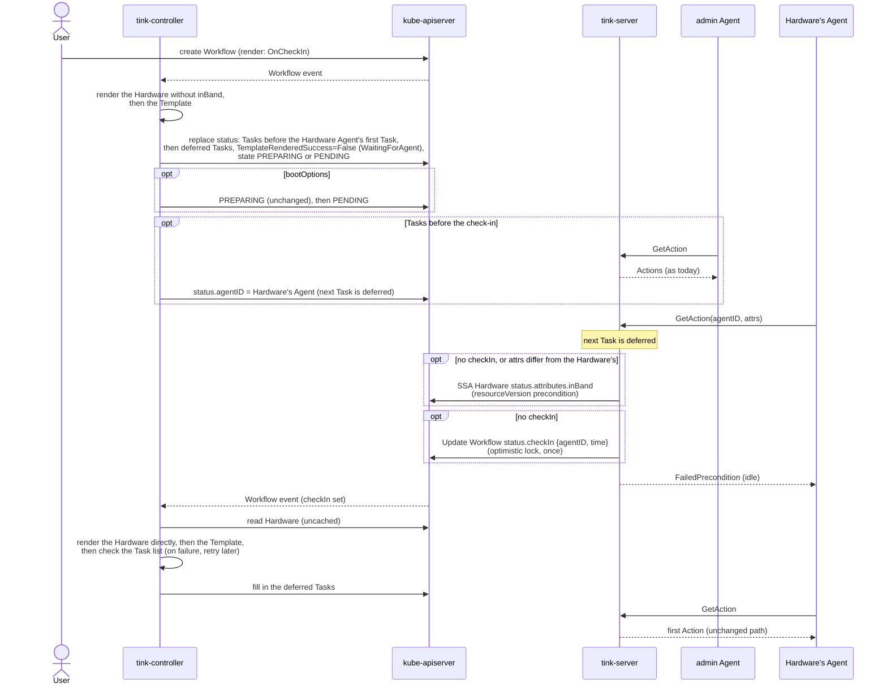

# Proposal: Rendering a Workflow's Template on Agent check-in

Issue: [#900](https://github.com/tinkerbell/tinkerbell/issues/900).

## 1. Problem

A Template is rendered when its Workflow is created, before the Agent has reported the machine's in-band attributes. So a Template can't use the attributes of the run it's rendered for.

Some Workflows also start with Tasks that must run before the machine can boot, on another Agent: for example, an administrative Agent that moves the machine's switch port to the provisioning VLAN. Those Tasks can't wait for the machine's Agent to check in.

## 2. Principles

1. **A Template is rendered twice, from the same Hardware.**
   - At creation, without in-band attributes. Tasks before the first Task on the Hardware's Agent use this render and run right away.
   - After the Hardware's Agent checks in, with its attributes. The remaining Tasks use this render.
2. **Every Agent is treated the same.** Tasks are split by whether they come before or after the check-in, not by Agent. Only the Hardware's Agent checks in, because its attributes are the only ones a Template sees.
3. **Attributes live in one place:** the Hardware's `status.attributes.inBand`. Every consumer reads them there: Smee, the Hardware's own spec templates, and Workflow Templates.
4. **The data is written before the signal.** Before tink-server records a Workflow's check-in, it writes the Agent's attributes to the Hardware, conditional on the Hardware it checked not having changed. So when a check-in is recorded, the Hardware on the API server has those attributes. The controller reads the Hardware from the API server, not a cache.
5. **Attribute writes, check-ins and renders are independent.**
   - An **attribute write** puts the Agent's attributes on the Hardware, in `status.attributes.inBand`. It's per Hardware, and happens before each first check-in and whenever the attributes change while a Workflow waits.
   - A **check-in** is the signal that the Hardware's Agent has arrived. It's per Workflow, recorded in the Workflow's `status.checkIn`, and written once.
   - A **render** is the controller's: one at creation, and one after the check-in, which is retried on failure with whatever attributes the Hardware has then.

   tink-server never looks at render state.
6. **Each component records only what it observed.** tink-server records what the Agent reported. The controller decides what happens to the Workflow.

## 3. Goals and non-goals

**Goals**

- A Workflow can opt in to rendering after its Agent checks in.
- Tasks that must run before the machine boots, on any Agent, still run first.
- No new Template syntax.
- Only tink-controller renders Templates.
- No changes to the Agent.
- Workflows that don't opt in behave exactly as they do today.
- `hw.spec.agentID` stays the authority on which Agent belongs to a Hardware.

**Non-goals**

- Rendering a Workflow again after its check-in render succeeded.
- Deferring the render per Task (that's for v1alpha2).
- A Task list that depends on in-band attributes, for example one Task per disk.
- Reassigning a Hardware's `spec.agentID` while the old Agent still has active Workflows. Delete those Workflows first (§11).
- A timeout or cleanup while waiting.
- Auto-enrolled Workflows.
- Manual edits to a Workflow's `status`, for example setting `status.state` back to `""` to run it again. They're unsupported and their behavior is undefined. To run a Workflow again, create a new one.

## 4. API

```go
// RenderPolicy picks when a Workflow's Template is rendered.
// +kubebuilder:validation:Enum=OnCreate;OnCheckIn
type RenderPolicy string

const (
    RenderPolicyOnCreate  RenderPolicy = "OnCreate"
    RenderPolicyOnCheckIn RenderPolicy = "OnCheckIn"
)

// The immutability rule is on Workflow, not WorkflowSpec: spec is optional,
// and a rule on WorkflowSpec doesn't run when spec is removed and added back.
// +kubebuilder:validation:XValidation:rule="(has(oldSelf.spec) && has(oldSelf.spec.render) ? oldSelf.spec.render : 'OnCreate') == (has(self.spec) && has(self.spec.render) ? self.spec.render : 'OnCreate')",message="spec.render is immutable"
type Workflow struct {
    // ...
}

// +kubebuilder:validation:XValidation:rule="!has(self.render) || self.render != 'OnCheckIn' || (has(self.hardwareRef) && self.hardwareRef != '')",message="render: OnCheckIn requires hardwareRef"
type WorkflowSpec struct {
    // ...

    // Render picks when the Template is rendered.
    // OnCheckIn requires hardwareRef, and the Hardware must have spec.agentID.
    // +kubebuilder:default=OnCreate
    // +optional
    Render RenderPolicy `json:"render,omitempty"`
}

type WorkflowStatus struct {
    // ...

    // CheckIn records that the Hardware's Agent checked in and its attributes
    // were written to the Hardware. It's set once, by tink-server, and never
    // replaced.
    // +optional
    CheckIn *CheckIn `json:"checkIn,omitempty"`
}

type CheckIn struct {
    // AgentID is the Agent that checked in.
    AgentID string `json:"agentID"`
    // Time is when tink-server received the check-in.
    Time metav1.Time `json:"time"`
}

type Task struct {
    // ...

    // Deferred means the Task's Actions are filled in after the Hardware's
    // Agent checks in. A deferred Task is never served.
    // +optional
    Deferred bool `json:"deferred,omitempty"`
}
```

There's no new Workflow state. The `TemplateRenderedSuccess` condition gets one new reason, `WaitingForAgent` (status False): some Tasks are waiting for the Hardware's Agent to check in.

An empty `render` means `OnCreate`. The API server sets the default, but code must not rely on it: objects built in Go, including in tests with a fake client, aren't defaulted.

There are no changes to the Hardware API.

A Workflow's status after creation, with a Task on an administrative Agent first:

```yaml
status:
  state: PENDING
  agentID: admin-agent              # the first Task's worker, as for OnCreate
  tasks:
    - name: "move switch port"      # from the creation render; runs now
      agentID: admin-agent
      actions: [...]
    - name: provision               # deferred: filled in after the check-in
      agentID: "aa:bb:cc:dd:ee:ff"
      deferred: true
      actions: []
    - name: "restore switch port"   # after the check-in, so also deferred
      agentID: admin-agent
      deferred: true
      actions: []
```

## 5. Who does what

| Component | Responsibility | Never does |
|---|---|---|
| tink-controller | The Workflow lifecycle: renders at creation and after the check-in, moves states | Talk to Agents |
| tink-server | Serves Actions, writes the Agent's attributes to the Hardware, and records check-ins (`status.checkIn`) | Change Workflow state at check-in, read Templates, or render. Action reports still set the state as today. |
| `Hardware.status.attributes.inBand` | The attributes last reported by the Hardware's Agent, and the input to the check-in render | Get written by anything other than tink-server, for the Hardware's own Agent |

## 6. States

```text
""  →  [PREPARING]  →  PENDING  →  RUNNING  →  …
```

The states are the same as for `OnCreate`. While Tasks wait for the check-in, the state doesn't change: it's PENDING if nothing has run yet, otherwise RUNNING. That's how an `OnCreate` Workflow already looks while it waits for an Agent. PREPARING runs before the first Task, as for `OnCreate`.

## 7. Behavior

### 7.1 Controller, state `""`, with `render: OnCheckIn`

1. Get the Hardware from `spec.hardwareRef`. It must exist and have `spec.agentID`, and it must render (`RenderedHardware`): a Hardware that doesn't render isn't served to Smee, so the machine couldn't boot.
2. **Render without attributes.** Copy the Hardware as read from the cache, not the `RenderedHardware` result from step 1, whose spec may already have been rendered from stale attributes. Remove `status.attributes.inBand` from the copy and render it directly (§7.4 step 3). Then render the Template from it, as today.
3. Check that the Template's data isn't empty, and that at least one rendered Task's worker is `hw.spec.agentID`.
4. On an error in steps 1 to 3, set `templateRendering: failed` and `TemplateRenderedSuccess=False` with the error, as today, stay in `""`, and retry. Because this happens before PREPARING, a broken Workflow is reported before the machine is power-cycled.
5. **Replace status**, as `OnCreate` does:
   - Tasks before the first Task on `hw.spec.agentID` are kept as rendered.
   - That Task and every Task after it keep only `id`, `name` and `agentID`, with `deferred: true` and `actions: []`. The CRD requires `actions`, so a placeholder carries an empty list rather than none.
   - `globalTimeout` comes from this render, and `status.agentID` is the first Task's worker, as today.
   - Clear `templateRendering`, and set `TemplateRenderedSuccess=False` with reason `WaitingForAgent`.
6. Move to PREPARING if boot options are set, otherwise to PENDING, as today.

A disabled Workflow runs steps 1 to 3, writes only `status.agentID`, and stays in `""`, as today. Unlike today, an error is returned and the Workflow retried, even when it's disabled, so it gets `status.agentID` once the Hardware and Template are ready. The `render` field is read only in state `""`.

Here and in §7.4, "retry" means returning the error so controller-runtime requeues the Workflow with its rate limiter. The reconcile doesn't sleep.

### 7.2 Controller, PREPARING, PENDING and RUNNING

- **PREPARING:** no changes.
- **Moving to the next Task's Agent:** `updateAgentIDIfNeeded` also moves `status.agentID` to a next Task that's deferred. Today it skips a next Task that has no Actions. This is how the Hardware's Agent finds the Workflow after Tasks on other Agents.
- **The check-in render** (§7.4) runs in PENDING or RUNNING.

### 7.3 tink-server, `GetAction`

A Workflow is **waiting** when its state is PENDING or RUNNING and its next Task is deferred. By construction, the first deferred Task is on the Hardware's Agent, and `status.agentID` is that Agent once the Tasks before it have finished (§7.2). Workflows in any other state, such as PREPARING, FAILED or TIMEOUT, are never waiting, even if their next Task is deferred.

The Agent's attributes are converted to the `Attributes` form exactly as for the existing first-Action write: converted, empty parts pruned, and `collectionMethod: agent` set.

Two separate rules apply to Workflows eligible for check-in (principle 5): the **attribute write**, per Hardware, and the **check-in**, per Workflow.

1. **Runnable work wins.** If any Workflow for this Agent has an Action that can be served to it, serve it as today. Deferred Tasks are never served, and never count as finished. Today, a Task with no Actions counts as finished.
2. **Otherwise, find the Workflows eligible for check-in.** Read the Hardware named by each Workflow's `hardwareRef` from the cache, by name; it's never taken from another lookup such as auto discovery. A Workflow is eligible for check-in when:
   - It's waiting.
   - Its next Task's worker is the polling Agent.
   - The Hardware's `spec.agentID` is the polling Agent.
   - The Agent sent attributes.

   Pick one: the first eligible Workflow without a `status.checkIn`, or else the first eligible Workflow. Its Hardware is the one used below. An Agent normally has one Hardware; Hardware objects that share a `spec.agentID` are already treated as an error elsewhere.
3. **Attribute write.** Write the converted attributes to the Hardware (below) when either:
   - the picked Workflow has no `status.checkIn`, so a check-in follows. The write happens even if the cached Hardware already shows the same attributes, because the cache can be behind the API server; or
   - the converted attributes differ from the Hardware's `inBand` (ignoring `lastUpdated`), or it has no `inBand`. The comparison is between typed `Attributes` values, not through a generic JSON map, which would turn integers into floats.

   On a conflict return `Aborted`, and on any other error return `Internal`. The Agent retries.
4. **Check-in.** If the picked Workflow has no `status.checkIn`, update its status with `checkIn = {agentID, now}`, using the cached Workflow `resourceVersion` as an optimistic lock. Step 3 just wrote the attributes, conditional on the Hardware being the version tink-server checked, so the Hardware on the API server has them.
   - On a conflict (the cached copy is stale, or the Workflow was deleted and recreated) or NotFound (the Workflow was deleted), return `Aborted`. The Agent retries. Attributes written in step 3 stay on the Hardware, which is harmless: they're from the Hardware's own Agent, and the retry writes them again before checking the Workflow in.
   - On any other error, return `Internal`.
5. Return `FailedPrecondition("waiting for render")`. The Agent treats this as idle and polls again.

At most one Hardware write and one check-in happen per poll.

**Writing the attributes.** Apply `status.attributes.inBand` with Server-Side Apply, as the first-Action write does, with `lastUpdated` set to `now`. Unlike that write, this one is conditional: the apply carries the `resourceVersion` of the cached Hardware that passed the `spec.agentID` check in step 2. If the Hardware changed since, for example because it was reassigned to another Agent or recreated, the API server rejects the write with a conflict, and the Agent retries against a fresher cache.

If nothing is runnable and nothing is checked in, but a Workflow for this Agent is waiting, return `FailedPrecondition`, as for PREPARING today. This applies to any waiting Workflow, including one that isn't eligible for check-in, for example because the Agent sent no attributes.

**Why the attribute write doesn't depend on the check-in.** A check-in happens once, and the controller retries a failed render by reading the Hardware again (§7.4). So when the Agent reports new attributes, for example after it restarts, or the Hardware lost them, for example because it was recreated, writing them to the Hardware is enough for the next render attempt to use them. This doesn't depend on any Workflow's check-in or render state. The Agent sends the same attributes on every poll, so after one write they match, and nothing more is written until another Workflow's first check-in. After their check-ins, Workflows waiting on one Hardware share each later write. A replica whose Hardware cache lags may decide to write again, but its write carries the old `resourceVersion` and is rejected. The same rejection is what makes the write before a first check-in reliable: a replica whose cache is behind gets a conflict instead of recording a check-in against attributes the Hardware no longer has.

The existing first-Action write doesn't change. It stays unconditional and best effort, so Workflows that don't opt in behave as today.

### 7.4 Controller, the check-in render

In PENDING or RUNNING, when `status.checkIn` is set and a Task is still deferred:

1. **Read the Hardware from the API server**, not the cache, using the manager's API reader (`mgr.GetAPIReader()`) for the Workflow's namespace. tink-server wrote the attributes before the check-in (§7.3), so this read has them or a later write from the same Agent.
2. Check that the Hardware's `spec.agentID` is `checkIn.agentID` and that it has `status.attributes.inBand`.
3. **Render the Hardware directly:** render its spec templates without the render store. The Hardware's spec and `.hardware.status.attributes.inBand` then come from the same object. This follows the same rules as the render store: when Hardware rendering is turned off (`--backend-kube-rendering-enabled`), the Hardware is used as read, and a reference that can't be resolved fails the render only if a template uses it.
4. Build the Template data from that Hardware as today, and render the Template.
5. Check that the rendered Task list matches status: the same number of Tasks, with the same names and workers, in the same order.
6. **On success,** fill in each deferred Task's Actions, volumes and environment from this render, keep its `id`, and clear `deferred`. The Actions are converted as the creation render's are today: each gets a fresh ID and state PENDING. Set `templateRendering: successful` and `TemplateRenderedSuccess=True`. Nothing else changes: not the state, the Tasks that already ran, `globalTimeout`, `bootOptions`, the other conditions or `checkIn`.
7. **On any error,** set `templateRendering: failed` and `TemplateRenderedSuccess=False` with the error, and retry. Each retry starts again at step 1, so it uses whatever the Hardware and Template hold then. To recover, fix the Template or the Hardware, or restart the Agent so it reports new attributes, which tink-server writes to the Hardware (§7.3 step 3). None of these reboots the machine, and none changes `checkIn`. The controller watches only Workflows, so a fix is picked up on the next retry, not immediately.

The creation render replaces status, as the `OnCreate` path does. The check-in render only fills in deferred Tasks.

### 7.5 Serving the first Action

No changes.

## 8. Sequence



## 9. Writing Templates

With `OnCheckIn`, the Template is rendered twice (§7): at creation without in-band attributes, and after the check-in with them. Before the check-in, `.hardware.status.attributes.inBand` is absent; after it, it's present.

An excerpt of a Template:

```yaml
tasks:
  - name: move switch port
    worker: admin-agent
    actions:
      - name: set vlan
        image: example.com/switch-vlan
        environment:
          SWITCH_PORT: {{ .switch_port | toJson }}
  - name: provision
    worker: {{ .hardware.spec.agentID | toJson }}
    actions:
      - name: stream image
        image: quay.io/tinkerbell/actions/image2disk
        environment:
          {{- $inBand := dig "status" "attributes" "inBand" dict .hardware }}
          DEST_DISK: {{ with $inBand }}{{ printf "/dev/%s" (index .blockDevices 0).name | toJson }}{{ end }}
```

The same value as a single expression, with all of its templating inside the value:

```yaml
          DEST_DISK: {{ with dig "status" "attributes" "inBand" dict .hardware }}{{ printf "/dev/%s" (index .blockDevices 0).name | toJson }}{{ end }}
```

Prefer this form: it keeps all of a value's templating inside the value. That's all v1alpha2 allows, because its Tasks are typed Kubernetes objects. A line like `{{- $inBand := … }}` isn't a field, so the API server would reject such a Task.

Both forms leave `DEST_DISK` empty in the creation render, which has no `inBand`. In the check-in render, `inBand` is always present, so a machine that reported no disks fails the render instead of running with an empty `DEST_DISK`. Restarting the Agent once the disk is visible recovers it (§11).

Three rules for `OnCheckIn` Templates:

- **The Template must render without in-band attributes,** because the creation render has none. Look them up with `dig` and a default, and use `with` around the result, as above; `with` alone doesn't protect a lookup of a missing key. This already applies to any Template used with `OnCreate`: a machine that has never checked in has no attributes either.
- **The Task list must not depend on in-band attributes.** The Tasks' names and workers, and their order, must be the same in both renders. Their Actions, environment and volumes may differ.
- **At least one Task must run on the Hardware's Agent** (`{{ .hardware.spec.agentID }}`). Tasks before the first one run before the check-in and never see in-band attributes, not even ones left from an earlier run. Tasks from it on, on any Agent, see the check-in's.

Also:

- The same Template works with both policies.
- With `OnCheckIn`, the attributes are the Hardware's when the check-in render runs: written by its Agent before the check-in, or later by the same Agent. The Agent collects them once, when it starts, so they're as fresh as the Agent's last start, not necessarily collected for this Workflow.
- With `OnCreate`, they're whatever the Hardware holds when the Workflow is created, possibly from an earlier run or empty.
- Attribute values come from the Agent and are untrusted (§10). Write string values with `toJson`, which quotes a string as one YAML value, and validate values that pick a device or reach a shell.

## 10. Security

- **Agents aren't authenticated.** `GetAction` trusts the Agent ID in the request; TLS authenticates tink-server, not the Agent. Anyone who can reach tink-server and knows a waiting Workflow's Agent ID, often a MAC address, can check it in and choose its attributes. The same caller can already be served that Agent's Actions today. What's new is that the attributes feed the render.
- **Attribute values are untrusted input to the Template.** Templates are rendered as text and then parsed as YAML. Unless the Template escapes it, a value containing a quote, a newline or YAML syntax can change the rendered Workflow's structure, for example by adding a command or a volume. `toJson` on a string value prevents that. Escaping for YAML doesn't make a value safe inside a shell command, so validate those values too, for example with `regexMatch`.
- **Attributes can shape Tasks on other Agents.** Tasks after the check-in are rendered with the machine's attributes whatever their Agent, for example a Task on an administrative Agent with access to a switch. The advice above matters most there.
- **Check-ins are limited.** tink-server writes attributes only from the Hardware's own Agent (`hw.spec.agentID`), and only while a Workflow is waiting for that Agent. Each write is conditional on the Hardware not having changed since that check. A Workflow is checked in once.

## 11. Edge cases

| Case | Behavior |
|---|---|
| Tasks on another Agent first (for example, an administrative Agent moves the switch port) | They run from the creation render. When they finish, the Workflow moves to the Hardware's Agent, which checks in, and the rest is rendered with its attributes. |
| The first Task is on the Hardware's Agent | Nothing runs before the check-in; every Task is deferred. |
| A Task after the check-in on another Agent (for example, restoring the switch port) | It's rendered after the check-in, so it can use the attributes, such as LLDP neighbors. |
| A Task before the check-in uses in-band attributes | It sees none. A direct reference fails the creation render, and the Workflow stays in `""` with the error. With `dig` and a default, it gets the default. |
| The Task list depends on attributes, or the Template was edited between the two renders | The check-in render's Task list doesn't match, so it fails and retries. Fixing the Template recovers the Workflow. Tasks that already ran aren't affected. |
| No Task on the Hardware's Agent | The creation render fails, and the Workflow stays in `""`. |
| A Task before the check-in fails | The Workflow fails, as today. |
| Global timeout | It comes from the creation render and starts at the first Action, as today. With Tasks before the check-in, the machine's boot counts toward it, the same as for `OnCreate`. |
| Several Workflows for one Agent | Runnable work is served first. At most one check-in per poll, so further waiting Workflows are checked in on later polls. Each Workflow's first check-in writes the Hardware; after that, Workflows waiting on one Hardware share each later write. |
| Workflow deleted and recreated under the same name | If tink-server's cache still has the old Workflow, the optimistic-lock update fails with a conflict. |
| Workflow deleted while still cached | The status update returns NotFound, and tink-server returns `Aborted`. |
| `hw.spec.agentID` changes while waiting | The deferred Tasks still name the old Agent, so the new Agent doesn't find the Workflow; recreate it. If the change happens after check-in, the controller's check in §7.4 step 2 fails and it retries until the Workflow is recreated. |
| `hw.spec.agentID` reassigned while the old Agent still has active Workflows | Unsupported (§3); delete the old Agent's Workflows first. A tink-server replica whose cache still has the old assignment can't overwrite the attributes while a Workflow waits, because those writes are conditional (§7.3). The unchanged first-Action write isn't conditional, so an old Agent with a running Workflow could still overwrite them in the brief window before the replica's cache catches up. |
| Agent with attribute detection off | It never checks in. The Workflow waits with `TemplateRenderedSuccess=False` (`WaitingForAgent`). |
| The Hardware's Agent polls while Tasks before the check-in are still running | `status.agentID` is still the other Agent's, so it finds no Workflow. If auto enrollment is enabled for the Hardware, that starts enrollment, as it does for an `OnCreate` Workflow on several Agents today. |
| The attribute write to the Hardware fails (for example, the attributes are too large for the object) | The Workflow isn't checked in, because the Hardware doesn't have the attributes. It still shows `WaitingForAgent`. tink-server logs the error and returns `Internal`, and the Agent retries. |
| The attribute write conflicts (the Hardware changed after tink-server's cache read) | tink-server returns `Aborted`, and the Agent retries against a fresher cache. |
| The Workflow update fails after the attributes were written | The Agent retries. The Workflow still has no `checkIn`, so the attributes are written again and the Workflow is checked in. |
| Attributes written again after check-in (the Agent restarted, or another Workflow's first Action) | The check-in render uses the newer attributes. They're from the same Agent, because tink-server only writes attributes from `hw.spec.agentID`. |
| Hardware deleted and recreated | Before check-in: the write before the check-in carries the old Hardware's `resourceVersion`, so it conflicts, and the Agent retries once tink-server's cache has the new Hardware. After check-in: the new Hardware has no attributes, so the render fails (§7.4 step 2). On a later poll, tink-server writes the Agent's attributes to it (§7.3 step 3), and the controller's next retry renders. If the new Hardware has a different `spec.agentID`, the render keeps failing; recreate the Workflow. |
| tink-server's cache shows attributes the Hardware no longer has (for example, the Agent restarted twice within the cache's lag) | The write before the first check-in conflicts, so no check-in is recorded until tink-server's cache catches up. |
| The render fails because the attributes are incomplete (for example, a disk wasn't visible when the Agent started, as with the §9 example) | Restart the Agent. It collects the attributes again, tink-server writes them to the Hardware (§7.3 step 3), and the controller's next retry uses them. Retries back off, so after many failures this can take up to the controller's maximum backoff, 16 minutes 40 seconds by default. |
| Several waiting Workflows for one Hardware fail to render | Nothing is written on each poll. The attributes are written once, when they change, and each Workflow's retries read them. |
| Hardware spec templates that use `inBand` | They're rendered without attributes at creation and with them after the check-in (§7.4 step 3). Smee uses the Hardware as stored, so they must also render without attributes; a Hardware that fails to render can't boot. §7.1 step 1 checks this before PREPARING. |
| Agent restarts after the check-in render | The Hardware may get different attributes later. The Workflow's Tasks don't change. |
| Workflow deleted while waiting | Same as deleting a PENDING Workflow today: allowPXE stays on and an ISO stays mounted. |

## 12. Upgrading

1. Apply the updated CRDs first. An older CRD drops unknown fields: `spec.render`, so the Workflow is rendered `OnCreate`; `status.checkIn`, so tink-server writes the check-in again on every poll; and `deferred`, so a deferred Task looks like an empty one.
2. Upgrade every tink-server and tink-controller replica.
3. Only then create `OnCheckIn` Workflows.

With older components still running:

- An older tink-server counts a deferred Task as finished, because it has no Actions, so it serves nothing past it. Its full status updates also drop `deferred` and `status.checkIn`. A Workflow that loses `deferred` can't continue and must be recreated.
- An older tink-controller renders an `OnCheckIn` Workflow at creation as if it were `OnCreate`, and never fills in deferred Tasks. Before downgrading, delete `OnCheckIn` Workflows that still have deferred Tasks.

## 13. What this drops from #1129

- The ULID `revision` on `Attributes`, and the clock-skew handling.
- Conditional (`resourceVersion`-precondition) SSA on the first-Action write. Only the attribute writes for waiting Workflows are conditional, and they use the `resourceVersion` tink-server already has in its cache.
- Uncached reads in tink-server, and the Workflow UID check.
- The `AWAITING_CHECKIN` state. Waiting shows in the deferred Tasks and the `TemplateRenderedSuccess` condition.
- The `AgentCheckedIn` condition, including the `WaitingForAttributes` reason, and the revision comparison.
- The cache and render-store lag analysis. The controller reads the Hardware uncached and renders it directly.
- Remembered-error ordering in `GetAction`.

## 14. Trade-offs

- **The Template is rendered twice.** The creation render decides which Tasks run before the check-in, and the check-in render fills in the rest.
- **Templates must render without in-band attributes,** and the Task list can't depend on them (§9).
- **The Workflow doesn't record the attributes it was rendered with.** They're on the Hardware, and can change after the render. `checkIn.time` says when the Workflow was checked in. The Hardware's `lastUpdated` says when its attributes were last written: at the check-in, or later, for example when the Agent restarted or at the first Action.
- **The check-in render may use attributes newer than the check-in's,** if the same Agent reported again in between. They come from the same Agent and are at least as fresh.
- **A check-in waits for the attributes to be on the Hardware.** If they can't be written, the Workflow isn't checked in. Because the attribute write is conditional, any other change to the Hardware between tink-server's cache read and the write, such as Rufio's out-of-band attributes or the allowPXE toggle, makes the Agent retry once. The first-Action write stays unconditional and best effort.
- **A failed check-in render picks up new attributes on its next retry, not immediately.** The controller watches only Workflows, and retries back off. A Hardware watch could make this immediate later.
- **One uncached Hardware read per check-in render attempt.** Retries are rate limited by the controller.
- **The controller renders the Hardware itself for each `OnCheckIn` render,** in addition to the render store. That's what makes the Hardware's spec agree with the attributes the Template sees.
- **`OnCheckIn` runs may write the Hardware twice,** once while waiting and once at the first Action. The first-Action write may carry the same or newer attributes; either way the rendered Tasks don't change. Keeping both means the existing path doesn't branch on the policy.
- **Check-ins aren't authenticated (§10).** This design doesn't change that, but the attributes now matter more.

## 15. Decisions

1. The opt-in is `spec.render: OnCreate | OnCheckIn`. It defaults to `OnCreate` and can't be changed, and `OnCheckIn` requires `hardwareRef`. The API server enforces all three.
2. Only tink-controller renders Templates.
3. The Agent that checks in is always `hw.spec.agentID`. Tasks before its first Task run before the check-in, on any Agent.
4. The Template is rendered twice: at creation without in-band attributes, and after the check-in with them. Tasks from the first Task on the Hardware's Agent are deferred until the check-in render, which must produce the same Task list (names, workers and order).
5. Deferred Tasks are marked `deferred: true` in status. There's no new Workflow state.
6. Attributes are stored only on the Hardware. The Workflow's `status.checkIn` records the Agent and the time, and is written once.
7. tink-server writes the Agent's attributes to the Hardware before each Workflow's first check-in, and while a checked-in Workflow waits, whenever they differ from its `inBand`. Every such write is conditional on the `resourceVersion` of the Hardware it checked. The check-in is recorded on the Workflow, with an optimistic-lock update, only after that write succeeds.
8. Both renders render the Hardware directly, following the render store's rules. For the check-in render, the controller reads the Hardware from the API server and checks its Agent and that it has attributes.
9. Attribute writes, check-ins and renders are independent (principle 5). The controller retries a failed check-in render with whatever the Hardware holds then. tink-server never reads render state.
10. The existing first-Action write doesn't change. Reassigning `spec.agentID` while the old Agent has active Workflows is unsupported.
11. At most one attribute write and one check-in per poll, and runnable work comes first.
12. Before PREPARING, the controller renders the Template and checks that the Hardware renders.
13. PREPARING runs before the first Task, as for `OnCreate`.
14. Render errors leave the Workflow's state unchanged, and it retries. There's no timeout and no cleanup.
15. The creation render replaces status, as `OnCreate` does; the check-in render only fills in deferred Tasks.
16. Manual edits to a Workflow's status are unsupported.

## 16. Implementation

1. **API:**
   - Add the `RenderPolicy` type, `spec.render` with its default, the `hardwareRef` rule on `WorkflowSpec`, the immutability rule on `Workflow`, `status.checkIn` and the Task's `deferred` field. Then regenerate deepcopy and CRDs.
   - Add `ResourceVersion` to the hand-written `HardwareApplyMetadata`. It isn't part of the CRD.
2. **kube backend:**
   - A `RenderHardware` call that renders a Hardware's spec templates directly, without the render store, following the store's rules (§7.4 step 3). It's used for both renders. The Template's `.references` are resolved as today.
   - `ApplyHardwareInBandAttributes` takes an optional `resourceVersion` precondition and returns conflicts as such.
3. **tink-server:**
   - Handle waiting Workflows in `GetAction` (§7.3), with the attribute write and the check-in as two separate rules.
   - Never serve a deferred Task, and never count one as finished.
   - One function that converts Agent attributes to `Attributes`, shared by the attribute write and the first-Action write.
4. **tink-controller:**
   - Pass the manager's API reader (`mgr.GetAPIReader()`) to the Workflow reconciler.
   - The `""` branch for `OnCheckIn` Workflows: the creation render without attributes, and the deferred Tasks (§7.1).
   - `updateAgentIDIfNeeded` moves to a next Task that's deferred (§7.2).
   - The check-in render in PENDING and RUNNING: read the Hardware uncached, check it, render it directly, render the Template, check the Task list, and fill in the deferred Tasks (§7.4).
5. **Docs:** the `render` field, §9 and its three rules, §10, the Hardware spec template limit from §11, that manual status edits and reassigning `spec.agentID` with active Workflows are unsupported, and the upgrade order from §12.

**Tests**

The API tests, the placeholder Tasks and the conditional Hardware write need a real API server (envtest). A fake client doesn't apply CRD defaults, CEL rules, required fields or `resourceVersion` preconditions on Server-Side Apply.

- **API:**
  - `render` defaults to `OnCreate`.
  - `OnCheckIn` without `hardwareRef` is rejected.
  - Changing `render` is rejected, including by removing `spec` and adding it back, and by removing `render` from an `OnCheckIn` Workflow.
  - A Workflow created before the upgrade, without `render`, can still be updated.
- **Controller:**
  - Missing `hardwareRef` or `hw.spec.agentID`, then fixed.
  - A missing, empty or unparseable Template, a Template with no Task on the Hardware's Agent, a Template that reads in-band attributes without a default, and a Hardware that fails to render, all stay in `""` and don't reach PREPARING.
  - The creation render never sees in-band attributes, even when the Hardware has some from an earlier run.
  - Tasks before the first Task on the Hardware's Agent keep their Actions. From that Task on, Tasks are deferred with `actions: []`, and the API server accepts that status.
  - Disabled Workflows get `status.agentID` once the Hardware and Template are ready, and are retried until then.
  - An empty `render` is treated as `OnCreate`.
  - PREPARING then PENDING, for each boot mode, with `TemplateRenderedSuccess=False` (`WaitingForAgent`).
  - `status.agentID` moves to the Hardware's Agent when the next Task is deferred.
  - No `checkIn` means no check-in render.
  - The Hardware is read from the API server, not the cache: a cache without the attributes still renders with them.
  - A Hardware without `inBand`, and an `agentID` mismatch, fail the check-in render.
  - Hardware spec templates see the attributes, and `outOfBand` is kept.
  - With Hardware rendering turned off, spec templates aren't rendered. An unused reference that can't be resolved doesn't fail the render.
  - A Task list that differs from the creation render (in count, a name, a worker or order) fails the check-in render.
  - Filled-in Tasks keep their IDs, and their Actions get fresh IDs and state PENDING.
  - The creation render uses the Hardware from the cache, not the render store's copy.
  - A check-in render error that recovers after the Template is fixed, and one that recovers after new attributes are written to the Hardware, without `checkIn` changing.
  - A Hardware recreated after check-in: the render fails until the attributes are written to the new Hardware, then succeeds.
  - The check-in render fills in only deferred Tasks. The Tasks that already ran, `bootOptions`, `globalTimeout` and the state are kept.
  - A Task after the check-in on another Agent is rendered with the attributes.
  - The `OnCreate` path is unchanged.
- **tink-server:**
  - A PENDING or RUNNING Workflow whose next Task is deferred is waiting and returns `FailedPrecondition`, also when the Agent sent no attributes.
  - A Workflow in PREPARING, FAILED or TIMEOUT whose next Task is deferred isn't waiting: no attribute write and no check-in.
  - A Workflow whose next deferred Task is on another Agent isn't checked in by the polling Agent.
  - Deferred Tasks are never served and don't count as finished.
  - Runnable work comes before check-in.
  - At most one check-in per poll, and `checkIn` is never replaced.
  - No write without attributes, or when the Agent isn't `hw.spec.agentID`.
  - A Hardware found by auto discovery under another name isn't used.
  - The attributes are written before the check-in, with the cached `resourceVersion`. A conflict returns `Aborted`, and any other failed Hardware write returns `Internal`; neither writes the check-in.
  - A first check-in always writes the attributes, even when the cached Hardware shows the same ones.
  - A cache that shows attributes the API server's Hardware no longer has: the write before the first check-in conflicts, and no check-in is recorded.
  - A cache that still has `spec.agentID` as the old Agent after a reassignment: the old Agent's write conflicts and doesn't change the Hardware.
  - After the Hardware write succeeds and the Workflow update conflicts, the retry writes the attributes again and checks the Workflow in.
  - While a checked-in Workflow waits, different attributes, or a Hardware without `inBand`, are written; the same attributes aren't.
  - Two waiting Workflows for one Hardware, both failing to render, don't cause a write on every poll.
  - A stale cached Workflow gets a conflict, and a deleted one gets NotFound; both return `Aborted`.
- **Templates:** both §9 forms render an empty `DEST_DISK` without `inBand`, render `/dev/<disk>` with it, keep a disk name containing quotes and newlines as one value, and fail the check-in render when `inBand` has no block devices.
